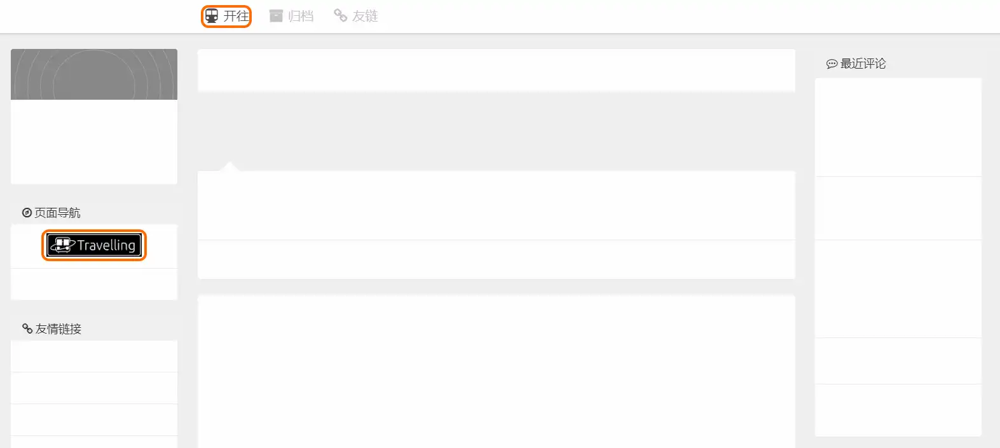
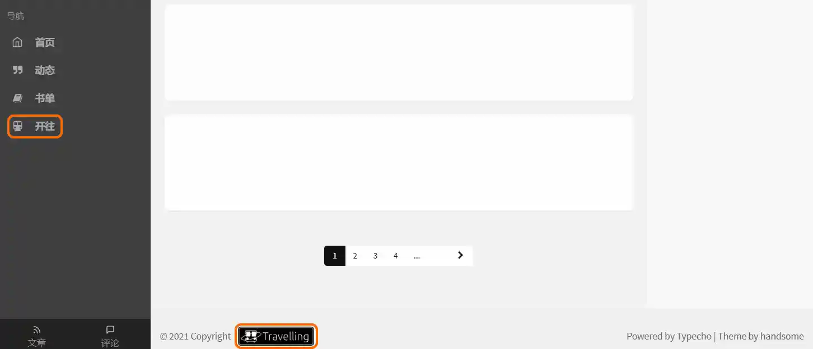

# 加入开往

## 要求

您的网站应满足下述所有要求。

### 原则要求

您愿意为开放的网络做出贡献，例：乐于分享知识经验。

### 网站建站时长

您的网站应已创办两个月以上。我们会根据网站内第一篇文章的发布日期计算。

### 网站更新、内容和质量

您的网站应有至少 10 篇**原创文章**，且原创文章**不应低于**文章总数的 70%，**整篇或大量使用** AIGC 的文章不计入原创文章，但计入文章总数。

以及您的文章**不应包含**以下内容：

- 违法违规等限制性内容，如：涉政敏感、色情、暴力、血腥；
- 影响访问体验的内容，如：侵入式广告和弹窗；
- 可在搜索引擎中搜到很多的相同的内容（即「内容农场」）；
    - 对多站点聚合、源站不提供的数据进行统计和规范转载文章不在此列；
    - 如果短时间内发布的文章大部分为使用AI生成的低创内容，维护组可将其视同内容农场驳回；
- 其它维护组认为的不适宜的内容。

同时，半年及以上未更新的网站的申请可能会被驳回，推荐您不定期或定期更新博文。

开往不反对使用 AI **辅助**博客创作。使用AI辅助写作（润色、查找资料等），**建议**注明使用 AIGC 技术辅助写作。维护组审核加入申请时由维护组成员人工判断是否为 AIGC，申请人可以依据运维规定要求维护组重审。

开往尊重每一位站长的创作自由，但也应兼顾公共展示环境及全年龄用户的观感。因此，即使内容**未明显触及**“限制性内容”规定，若涉及边缘性非全年龄内容，建议站长采取以下措施：

1. **显著的 NSFW 提示**：在文章页面及首页列表等入口位置，设置清晰、醒目的 Not Safe For Work（NSFW）提示，确保用户在点击前即可获知内容属性。
2. **RSS 输出隐藏**：通过技术手段（如分类、标签或插件设置）将该类文章从公共 RSS 抓取范围中移除，仅保留站内直接访问路径。
3. **降低公共曝光**：尽量避免此类内容出现在首页推荐、聚合展示或对搜索引擎可见的摘要中。
4. **其他**：其他等提示或减少传播的措施

::: info 对于非博客类网站

若您的网站类型是非博客类网站，您也可以申请加入开往，但通过的概率很低。申请人可以依据运维规定要求维护组重审。

单页面的个人主页网站有很大可能会因为内容不丰富被驳回，建议用多个页面详细介绍；导航网站视具体情况而定。若它们链接了博客子站，则您的博客子站需要符合上述的要求。其他类型网站维护组将视情况而定。

:::

### 网站访问情况

您的网站须可正常访问，以巡查机器人是否可访问和人工巡查时域名未过期未脱离原先主体为准，且加载时间不宜过长，否则可能会使巡查机器人访问超时。

::: info 关于巡查机器人的网络环境

目前巡查节点有三个，分别位于：

- 香港初七云
- 上海腾讯云
- 南京电信家宽

:::

同时，我们强制要求启用 HTTPS。可行情况下推荐您启用 HSTS。

### 网站域名

我们**强烈建议**站长使用自费购买的域名。当然，您也可以使用非付费域名，审核要求方面与自费域名没有区别。

我们暂不接受使用 [Public Suffix List](https://publicsuffix.org/list/public_suffix_list.dat) 内未列出的非付费域名的申请，除非您的网站质量极高。

::: danger 可能会先删除后通知的情形

**无论您是否使用付费域名**，当开往发现您的网站**长期处于**以下状态时，均保留先**删除**后通知的权利：

- DNS 解析错误
- 域名或网站控制权疑似易主
- 内容出现严重违规
- 不可访问（404等）

在网站**删除**后，您需要重新提交申请才能恢复访问。

:::

### 网站已放置开往外链

您的网站须将开往的外链 `https://www.travellings.cn/go.html` 放置在**您的首页区域**，例如顶栏、侧栏。对于移动端设备，您仅需要让访客找得到开往外链即可。

- 如是英文导航，可使用 `Travelling` （而非 Travelling**s**）；
- 如需使用图标或 Emoji，推荐使用与火车地铁相关的图标，其次可选火箭飞船图标；
  - 若您正在使用 Font Awesome 6，可选用 [`fa-train-subway`](https://fontawesome.com/icons/train-subway?f=classic&s=solid)，若为 Font Awesome 5 则可选用 [`fa-subway`](https://fontawesome.com/v5/icons/subway?f=classic&s=solid)
  - 若您想使用 Material Icons ，推荐 `<mdui-icon-train></mdui-icon-train>`；
  - 若您想使用 Emoji，推荐 `🚇`；
  - 我们 **不再推荐** 纸飞机图标，易与 Telegram 混淆；

如果您想多多支持开往，或是您的主题预置了开往外链、但它在手机端不可见，您可以额外在您的网站的其它位置放置开往外链。

- 动图 GIF：`https://www.travellings.cn/assets/logo.gif`
- 深色 PNG：`https://www.travellings.cn/assets/b.png`
- 浅色 PNG：`https://www.travellings.cn/assets/w.png`
- 方形 PNG：`https://www.travellings.cn/assets/travelling.png`
- 方深 PNG：`https://www.travellings.cn/assets/travelling-dark.png`
- 方浅 PNG：`https://www.travellings.cn/assets/travelling-light.png`
- 矢量 SVG：`https://www.travellings.cn/assets/logo.svg`
- 全部图片素材：可查阅`assets` 文件夹。
- 💡 参考代码：（logo.gif 可替换为上方的其他图片，以适应您的网页主题；width 可限制图片的大小，让徽标看起来更合适。）

```html
<a href="https://www.travellings.cn/go.html" target="_blank" rel="noopener" title="开往-友链接力">
    
</a>
```

> 若以上图片素材在部分地区加载缓慢，可尝试将链接中的 `https://www.travellings.cn/assets/` 替换为 `https://cdn.jsdelivr.net/gh/travellings-link/travellings/assets/`。

::: info 示例

若您不清楚要在网站的哪个位置放置开往外链，可参考如下示例。




:::

::: warning

开往维护组对加入规则有制定、修改与解释以上内容的权利。若以上内容有修改，则按照最新版本的内容执行，内容修改后恕不另行通知。

:::

## 申请

请前往开往的 [GitHub Issues 页面](https://github.com/travellings-link/travellings/issues) 并提起一个新的 Issue，并选择「申请收录」的 Issue 模板。

> 对于一个独立域名下申请加入开往的不同网站，如果它们的内容相似或类型相同，我们将会收录其中一个网站，或是收录它们的引导页。

我们会在空闲时间内审核您的网站。若您的加入申请超过 1 个月还未审核，可以 @ 最近活跃的维护组成员，或通过其它我们已经公示的联系渠道联系。

您的申请会因为一些原因被驳回。并且，若您在 15 天内未跟进回复，我们会关闭您的 Issue，届时需要您重新申请。

## 通知

开往可能会通过 GitHub Issue 或您自行填写的联系邮箱与您进行后续联系。具体的联系方式与您在申请中的选择一致。

若您的网站**连续 3 次**未能通过自动巡查，巡查机器人会自动尝试与您取得联系，在您的网站问题修复完毕之前，开往会**暂停**对您网站访问的跳转。

若您的网站**连续 20 次**未能通过自动巡查，且期间**没有**通过自动发送的邮件中**指定的**邮件地址与维护组取得联系或**主动整改**完毕的，开往**可能**以无法取得联系为由删除您的站点。届时如果需要恢复，您需要再一次提交申请。

**巡查机器人自动发送的提醒也视为警告与限期整改**，警告与限期整改的要求见下一节。

其他在人工巡查时发现的问题，开往项目组的相应成员可能会使用组内个人邮箱（以 travellings.cn 结尾）与您取得进一步联系。

后续，随着巡查流程的进一步完善，您可能收到其他类型的邮件，这取决于后续的开发计划。开往自动自动发送的邮件地址均为 `noreply@travellings.cn`。

## 巡查处理

若项目组发现站点存在发布违法内容、内容农场等行为，而站点未提前告知或主动退出的，项目组将采取以下措施：
1. **警告并暂停跳转**：对首次违规且情节较轻的成员站，项目组将以邮件或 Issue 等形式发出警告，并在其完成整改前暂停该站点在开往的跳转服务。
2. **限期整改**：站长应在收到警告后14日内完成整改并回复项目组。整改通过后恢复跳转。
3. **永久移除**：对逾期未整改、重复违规，或涉及严重违法违规内容（如色情、暴力、血腥等）的站点，项目组将予以永久移除，并视情况列入黑名单；被列入黑名单的站点不再接受重新加入申请。

## 参与项目

如果你对我们跳转页的样式不满意，欢迎你在 `public` 文件夹中提交新的样式，只需几步，即可自定义你的样式!

> 1. 涉及到的所有的图片必须为 SVG
> 2. 必须为单页 html，如有 css 可以写入 html 头，JS 库请使用外部公共 CDN
> 3. 底部包含开往备案号 和 指向 [开往偏好设置](https://www.travellings.cn/preference) 的链接
> 4. 嵌入 `https://www.travellings.cn/assets/js/go.js` 可直接实现跳转逻辑，并自动使用用户的偏好设置
> 5. 设计精美/有创意
> 6. 请一并修改 [其他页面一览](/docs/pages)，加入你的页面描述和截图
> 7. 请一并修改 **开往偏好设置** （位于 `.vitepress/theme/components/Preferences.vue`），将你的自定义页面加入到设置菜单中（位于第 `34` 行）
> 8. 提个 Pull Request，并 @ 最近活跃的开往维护组成员

:::tip

如果你是新手，可以在原有跳转页的基础上进行修改~

:::

::: warning

如果你是以默认的 `go.html` 为基础进行修改的，请**务必先删除** `<head>` 中的以下代码：

```html
<script>
    const customPage = localStorage.getItem("t_preference_page");
    if (customPage) {
        location.href = "./" + customPage;
    }
</script>
```

以上代码用于实现从默认页跳转到用户设置的自定义页，如果页面本身就是自定义页便会造成**循环跳转**。

:::
